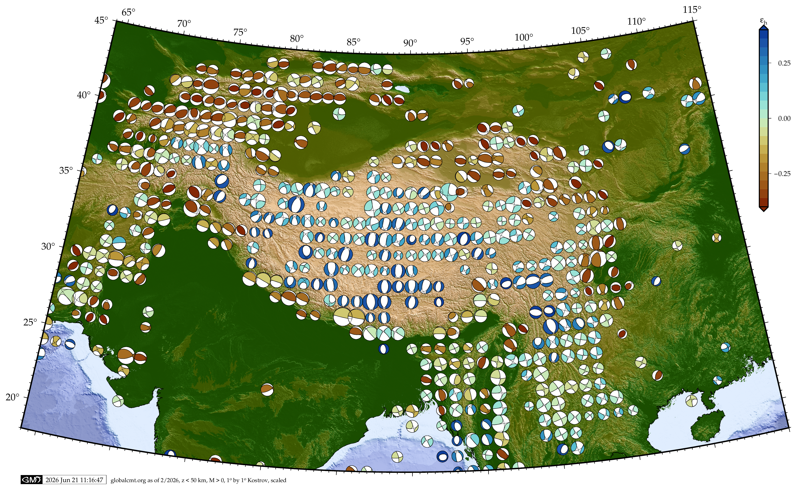

# bin_catalog

Tools to read earthquake focal mechanism and moment tensor catalogs,
bin or sample them in space, perform Kostrov summations, and invert
the mechanisms for stress. Written in C, with bash, GMT, and awk
helpers for plotting.

<p align="center">

</p>

## What it does

- Reads AKI & Richards style (strike, dip, rake) catalogs, Global CMT
  style moment tensor catalogs, and plain location and magnitude lists
  (formats in [doc/formats.md](doc/formats.md)).
- Sums moment tensors per grid cell (`bin_catalog`), per regular
  sample point with a nearest neighbor criterion (`nsample_catalog`),
  or at arbitrary points read from stdin (`psample_catalog`). Output
  is the normalized tensor, a moment scaled tensor, and CLVD measures.
  An optional Monte Carlo loop perturbs the mechanism orientations to
  estimate the spread of the normalized sum.
- Inverts the mechanisms of each cell or sample for the deviatoric
  stress tensor after Michael (1984, 1987), with an uncertainty from
  random sweeps over the choice of nodal plane, and after Vavryčuk
  (2014), at fixed friction and with a scan for the friction that
  maximizes fault instability, including a bootstrap on the latter.
- Merges catalogs, converts moment tensor catalogs to best fitting
  double couples or to moment and magnitude lists, computes auxiliary
  planes, and fits Gutenberg-Richter b values with several estimators.

Every program and its options are described in
[doc/programs.md](doc/programs.md); input and output formats in
[doc/formats.md](doc/formats.md).

## Repository layout

| Path | Content |
| --- | --- |
| `src/` | C sources of all programs and library routines |
| `src/experimental/` | k-d tree search experiments, not built by default |
| `include/` | headers; `catalog.h` holds data structures and constants, `proto.h` the prototypes |
| `eispack/` | EISPACK eigenvalue routines (Fortran) built as a static library; a prebuilt x86_64 copy is included |
| `scripts/` | `plot_kostrov` (GMT plotting driver), `region_parameters`, `kostrov_to_lonlatazi1`, and awk helpers in `scripts/awk/` |
| `test/` | regression tests (`run_tests.sh`), unit test sources, a small Southern California test catalog (`test.aki`), reference output |
| `doc/` | documentation and figures |
| `old/` | superseded headers kept for reference |
| `plot_kostrov` | symbolic link to `scripts/plot_kostrov`, kept in the top directory for backward compatibility; the script resolves its own location, so the link works but a copy would not |
| `bin/`, `objects/` | created by `make`, not tracked |

## Building

Requirements: a C compiler, GNU make, and gfortran if the EISPACK
library has to be rebuilt for your architecture (`eispack/x86_64/`
ships prebuilt). The tests and the plotting scripts need `gawk`;
plotting additionally needs GMT 6 with classic-mode command links
(`psxy` and so on).

```
make            # builds eispack if needed, all programs, and the test binaries into bin/
make test       # runs test/run_tests.sh against bin/
make clean      # removes object files
```

`CFLAGS` in the `Makefile` defaults to `-O3 -march=x86-64-v3`; adjust
for other hardware. Remove `-DHAVE_SINCOS` from `SINCOS_DEF` if your
libm has no `sincos`.

## Quick start

A Southern California test catalog with 854 events is in `test/test.aki`.
The following bins it on a 0.2° grid within the default region and
depth range, sums the mechanisms, and inverts each cell with at least
five events for stress:

```
bin/bin_catalog --dx 0.2 --min-events 5 --out-prefix kostrov test/test.aki
```

This writes `kostrov.0.2.0.2.0.norm.dat` (normalized Kostrov sum),
`kostrov.0.2.0.2.0.scaled.dat`, `kostrov.0.2.0.2.0.clvd.dat`,
`kostrov.0.2.0.2.s.dat` (Michael stress), `kostrov.0.2.0.2.smn.dat`,
`kostrov.0.2.0.2.ds.dat` (Vavryčuk, friction 0.6), and
`kostrov.0.2.0.2.bs.dat` (Vavryčuk, best friction). Each row holds
six tensor components followed by longitude, latitude, and the number
of events, in the order and units given in
[doc/formats.md](doc/formats.md). `bin/bin_catalog -h` lists all
options with their defaults.

To sample at points of your own instead of at grid nodes:

```
echo -117.5 34.0 | bin/psample_catalog --nmin 10 --dist-max 25 --out-prefix p test/test.aki
```

`scripts/plot_kostrov` shows one way to turn the output into maps with
GMT; `scripts/kostrov_to_lonlatazi1` reduces a summation file to
longitude, latitude, and the azimuth of the largest horizontal
extensional eigenvector.

## Conventions worth knowing

- Output locations are the grid nodes for `bin_catalog` (events within
  ±dx/2, ±dy/2 of a node belong to it) and for `nsample_catalog`
  (search centers), and the input points for `psample_catalog`.
  `test/run_tests.sh` checks these conventions and a number of edge
  cases.
- Tensor components are written in the order rr, rt, rp, tt, tp, pp
  (spherical r, θ, φ). `doc/formats.md` gives the mapping to GMT
  `psmeca` and to north, east, up.
- The last column of an AKI format catalog is read as seconds since
  1970-01-01 00:00 UTC. When building that column, use a UTC
  conversion (`mktime(..., 1)` in gawk, `calendar.timegm` in Python,
  `date -u`); a local-time conversion shifts every event by the time
  zone offset. Diagnostic output prints these times as UTC.
- Events with strike, dip, and rake all zero, or with a strike outside
  0 to 360°, are reported on stderr and skipped when reading AKI
  catalogs. Entries within 0.2 km, 0.4 km depth, and 5 s of an
  earlier entry are treated as duplicates and only the larger
  magnitude is kept; `merge_catalog` uses 1 km, 15 km, and 5 s. The
  thresholds are defined in `include/catalog.h`.

## Credits and references

The repository contains C versions of Andy Michael's stress inversion
code, routines following Vavryčuk (2014), eigenvalue routines from
NETLIB EISPACK, and moment tensor handling adapted from GMT 4.5.18
`psmeca`. Their respective copyright and licensing terms apply; see
`COPYRIGHT`. Parts of the code were written with the help of Claude
(Anthropic) from June 2026 onward.

Kostrov, B. V. (1974), Seismic moment and energy of earthquakes, and
seismic flow of rock, Izv. Acad. Sci. USSR, Phys. Solid Earth, 1,
23-44.

Michael, A. J. (1984), Determination of stress from slip data: Faults
and folds, J. Geophys. Res., 89, 11517-11526.

Michael, A. J. (1987), Use of focal mechanisms to determine stress: A
control study, J. Geophys. Res., 92, 357-368.

Vavryčuk, V. (2014), Iterative joint inversion for stress and fault
orientations from focal mechanisms, Geophys. J. Int., 199, 69-77.

(c) 2020 - 2026 Thorsten Becker, thwbecker@post.harvard.edu. Original
parts of the code are released under the GNU General Public License,
see `COPYRIGHT`.
